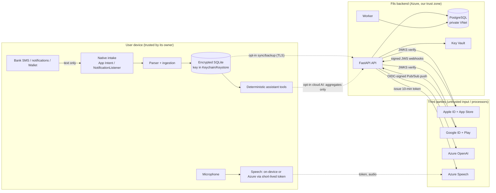

# Fils architecture

Fils is a local-first personal finance app for Kuwait. The phone is the system of record. The
cloud backend is optional: it adds sign-in, backup and sync, household sharing, store-billing
verification, and proxies for cloud AI and speech. Every core expense-tracking feature works
offline and without an account.

## Components

| Layer | Component | Where |
|---|---|---|
| Mobile (Flutter 3.50, Dart 3.14) | UI, design system, bilingual strings (AR/EN, RTL) | `fils/mobile/lib/ui`, `lib/features`, `lib/l10n` |
| | Domain core: money (integer minor units), Kuwait time and salary cycles, ledger invariants | `lib/core/money`, `lib/core/time`, `lib/core/ledger` |
| | Deterministic Kuwait bank-message parser, bank registry, merchant directory, sanitizer | `lib/core/parsing` |
| | Ingestion pipeline (dedupe, account routing, pending→settled, refunds, transfers) | `lib/data/ingestion.dart` |
| | Encrypted local DB (drift + SQLite3MultipleCiphers), outbox, audit log | `lib/data/db`, `lib/data/store.dart` |
| | Sync engine (outbox push, cursor pull, conflicts, tombstones) | `lib/data/sync/sync_engine.dart` |
| | Voice expense parser (Arabic/English numbers, dinar/fils) | `lib/core/voice` |
| | Assistant: typed deterministic tools, on-device intent router; cloud LLM only for wording | `lib/core/assistant` |
| | Native intake: iOS App Intents (Shortcuts message and Wallet automations), Android NotificationListenerService (`play` flavor), SMS receiver (`sms` flavor only) | `fils/mobile/ios`, `fils/mobile/android` |
| Backend (FastAPI, Python 3.13) | API: auth, consents, sync, households, ingest/AI, assistant proxy, voice token, billing, webhooks | `fils/backend/fils_api/routers` |
| | Worker: Postgres job queue (`FOR UPDATE SKIP LOCKED`) for export, account hard delete, statement extraction, retention | `fils/backend/fils_api/worker.py` |
| | PostgreSQL 16 (Alembic migrations) | `fils/backend/alembic` |
| Azure | Container Apps (API, worker, migrate job), PostgreSQL Flexible Server (VNet-private), Key Vault, ACR, Storage, Log Analytics and App Insights | `fils/infra/azure` |
| External | Apple and Google identity (JWKS), App Store Server Notifications, Google Play RTDN, Azure OpenAI, Azure Speech, Azure Document Intelligence | provider modules under `fils_api/providers` |

## Trust boundaries

Boundary rules:

- **Message text, PDFs, CSVs and merchant names are untrusted data.** They are never instructions
  to the parser or the LLM. Cloud extraction is accepted only when each value appears verbatim in
  the input.
- **The device never holds long-lived provider secrets.** Azure Speech uses a token of about 10
  minutes from `/v1/voice/token`, and LLM calls go through the backend proxy.
- **The server never receives a bank password or card credential.** Nothing initiates payments.
- **Sign-in, backup and sync are separate decisions.** Signing in uploads nothing. Sync requires the
  `cloud_sync` or `cloud_backup` consent, which the server enforces (`403 consent_required`).

## Data flows

### Capture (iOS)

1. The user creates a personal automation in Shortcuts: a Message trigger filtered by the bank sender
   and/or keywords such as `KWD`, running Fils' App Intent with the message text.
2. The App Intent writes the text into the app-group inbox, protected so it works after first unlock,
   and returns quickly.
3. When the app runs (foreground or background refresh), it drains the inbox. Each item goes through
   the parser, then account matching, then dedupe, then the ledger or the review queue.
4. An optional Wallet "Transaction" automation feeds merchant and amount, which are deduplicated
   against the bank SMS.

### Capture (Android)

`NotificationListenerService` reads notifications only from the user-allowlisted bank apps and
filters them before persisting. SMS capture exists only in the `sms` build flavor (see
`store-submission.md`).

### Sync

The local write goes to the outbox. `POST /v1/sync/push` carries `base_version`, and a mismatch comes
back as `conflict` for the user to resolve. `GET /v1/sync/pull?cursor=` returns changes by server
change sequence, including household scope. Tombstones are permanent. Local data is bound to one
cloud user id, so signing in as another user never merges data.

### AI assistant

The question is first routed on the device. If cloud AI is consented and configured, the device
sends the conversation plus tool schemas to `/v1/assistant/turn`. The model may only call declared
tools; the device executes them on local data and returns aggregates. Every number comes from
deterministic code (`lib/core/assistant/tools.dart`). The server enforces consent, rate limits and a
monthly token budget.

### Voice

Push-to-talk records with a visible state. Transcription uses on-device recognition or Azure Speech
REST with the short-lived token. The transcript goes to the voice parser, which produces an editable
draft the user confirms. Raw audio is not persisted.

## Environments

| | Development | Staging | Production |
|---|---|---|---|
| Backend | local `docker compose` or uvicorn | `rg-fils-staging` (B1ms Postgres, 1 API replica) | `rg-fils-production` (B2s Postgres, 2–6 API replicas, geo-redundant backup, 35-day PITR) |
| Entitlements | all unlocked (`dev_unlocked`) | all unlocked (`dev_unlocked`) | verified store purchases only |
| Demo session | enabled | enabled | 404 |
| `/docs` | on | on | off |
| App build | `FILS_ENV=development` | `FILS_ENV=staging` (TestFlight / Play internal) | `FILS_ENV=production` |
| Secrets | `.env` (placeholders) | Key Vault | Key Vault (purge protection) |
