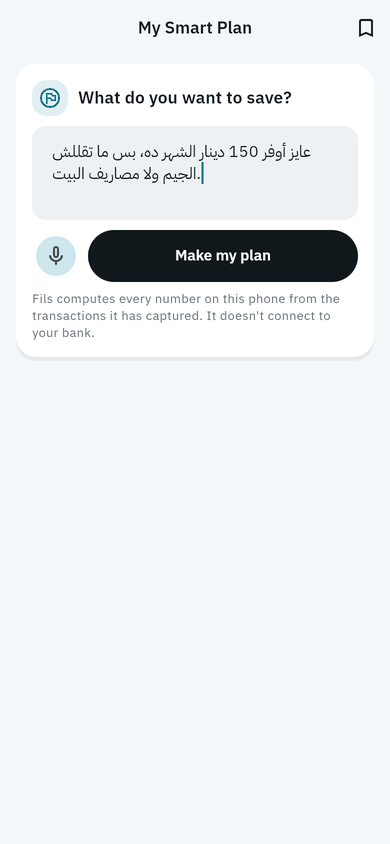

# My Smart Plan (خطتي الذكية) — Fils Copilot

A user says or types a goal, for example *"عايز أوفر 150 دينار الشهر ده، بس ما تقللش الجيم ولا مصاريف البيت."* Fils then:
1. understands the target, deadline, protected categories, and any stated income or commitments;
2. checks the data it actually has;
3. asks only what's missing;
4. proposes up to three changes with their computed impact;
5. writes nothing until the user previews and confirms.

## How it works

| Step | Who does it | Code |
|---|---|---|
| Understand the request | **Live AI** through the backend gateway (with consent), or the **basic local planner** (AR Gulf/Egyptian/MSA + EN parser) | `lib/data/planner/cloud_planner.dart`, `lib/core/planner/goal_parser.dart` |
| Compute every amount | Deterministic code, integer fils, on the device | `lib/core/planner/plan_engine.dart` |
| Explain | Live AI may write text that cites numbers **only** as `{fact:ID}` references; the device renders the amounts from computed facts. Without AI, the local templates are used, labelled "Basic local planner" | `cloud_planner.dart` (`narrativeOk`, `renderNarrative`, `localExplanation`) |
| Preview → Confirm → Apply → Undo | Local database transaction | `lib/data/planner/plan_service.dart` |
| UI | Home entry "خطتي الذكية", plan screen, progress card | `lib/features/smart_plan/` |

### What the numbers are

Every figure is a **fact** with a source, shown next to it:
- **Observed** (من عملياتك): computed from captured transactions.
- **You said** (أنت قلت): stated by the user.
- **Assumption** (افتراض): a planner rule, shown and editable.

The rules:
- **Baseline per category** is the average of the last complete pay cycles Fils actually covered (up to 3). A cycle counts only if capture had started and it has activity. **Missing history is never treated as zero.** With no complete cycle, the planner asks for usual monthly spending and plans on overall spending only.
- **Ledger rules are reused** (`totalsFor`): transfers never count as spending, refunds offset spending, declined and void rows don't count, and pending authorizations do count (this is disclosed). Held possible duplicates have no transaction, so they never count. Currencies are never mixed; spending in other currencies is reported separately and never converted. Goals in a non-base currency are refused.
- **Income** is the amount the user stated, otherwise the observed average of salary and other income.
  - If income varied by more than 20 %, the lowest recent cycle is used and labelled as an assumption.
  - If a covered cycle has no income at all, the planner asks rather than assuming zero.
- **Commitments** are active recurring payments plus any the user stated. They're floors: never cut.
- **Cuts** come only from categories that aren't protected, each capped by a stated percentage, and never below what's already spent or committed in the cycle.
  - Caps: dining, shopping, entertainment and travel 30 %; subscriptions 50 %; personal care 25 %; fitness and other 20 %; groceries, fuel and transport 15 %; telecom 10 %.
  - Rent, bills, health, education, installments, fees, charity, family and cash are never cut.
  - Limits move in 0.500 KWD steps. At most 3 actions.
- **Infeasible goals** get computed alternatives only: the largest reachable target, the months needed at that pace, or the savings from allowing a protected category to be cut. No savings are invented.

### Adjusting

The user can:
- protect or unprotect any category;
- step a proposed limit up or down. The value is clamped to what's already spent and to the expected amount, and marked "Your edit".
- include or exclude each action.

The plan recalculates immediately after every change.

### Applying

- **Preview** reads only: it makes no writes, which a test verifies.
- **Apply** runs in one transaction. The plan row is inserted first and acts as the idempotency claim, so a double tap, a retry after a crash, a second database connection or a restart can never apply the same plan twice.
  - It only creates or updates the selected **cycle budgets**, keeping each budget's existing rollover and alert settings, and optionally creates one **savings goal**.
  - It never edits transactions and never moves money.
  - An earlier plan for the same cycle is marked superseded.
- **Undo** restores the exact previous values and removes what the plan created. A budget the user edited after applying is kept as the user set it, and the app says so. Undo is idempotent.
- **Schema v5** adds two local tables, `smart_plans` and `smart_plan_changes`. They're never synced; the budgets and goals they touch sync as before. The upgrade is tested on a real v4 database generated by the `accbad4` code.

### Follow-up

- The progress card compares actual spending with each accepted limit. A category is flagged when it's over its limit, or spending faster than the cycle is passing (10 % allowance, after the first 20 % of the cycle).
- **Suggest an updated plan** recalculates and explains each change, for example *"Food: limit 120.000 → 140.000 because 130.000 is already spent."* Nothing changes until the user reviews, previews and confirms.
- **Memory:** "Remember these protections" stores protected categories in a local setting, only when the user taps it. The memory sheet lists them, with remove and "Reset everything".
  - The app states: *stored only on this phone; Fils doesn't use it to train any AI model.*

## Privacy and reliability

**Cloud AI requires explicit consent.** The setting is checked on the device, and the server enforces `cloud_ai` consent per user.

**What's sent:**
- To understand: the request text, sanitized with card- and account-like digit runs masked; category ids; locale; today's date; the cycle start day.
- To explain: computed facts as `{id, short category-level label, "NNN.NNN KWD", source}`, the action ids, the status and limitation codes.

**Never sent:** transactions, merchant names, account or card identifiers, raw bank messages, household data.

**Server side** (`POST /v1/assistant/plan`):
- The request models forbid extra fields, so a client *can't* send merchant or account data.
- Tool schemas are defined on the server and the model is **forced** to call one of them.
- Arguments are validated: types, ranges, and category enums.
- Explanations with self-written digits, unknown fact references, foreign action ids or URLs are rejected.

**Untrusted text:** the user's words and every label are wrapped as untrusted data. The model's output can't change an amount, because the device re-validates every amount against the user's own words (`validateAiIntent`), and every displayed amount comes from facts.

**Limits:**
- credentials stay server-side;
- per-user monthly token budget (shared with the assistant);
- `assistant` rate-limit group (30 requests per minute);
- `max_tokens` of 300 (understand) and 500 (explain);
- HTTP timeouts on both device and server.

**When AI isn't available** (consent off, no server, signed out, provider not configured, quota, offline or invalid output), the basic local planner runs. It's labelled as such, with the reason. Canned text is never labelled live AI.

## Demo scenarios (synthetic data)

These are shown only in demo mode, as chips on the plan screen labelled "Demo scenarios (synthetic data)":
- Egyptian: *"عايز أوفر 150 دينار الشهر ده، بس ما تقللش الجيم ولا مصاريف البيت."*
- Kuwaiti, too ambitious: *"ابي اوفر 900 دينار هالشهر بس لا تقرب النادي"*
- English, 3 months: *"I want to save 600 KD in 3 months but keep groceries as they are"*

## Status

| | Status | Evidence |
|---|---|---|
| **Local-tested** | Yes | Planner, parser, persistence, cloud client (mocked HTTP), controller and app UI flow (`test/core/planner_test.dart`, `plan_service_test.dart`, `cloud_planner_test.dart`, `smart_plan_controller_test.dart`, `smart_plan_ui_test.dart`); backend endpoint (`backend/tests/test_plan_ai.py`); device ↔ live local gateway E2E (`test/e2e/plan_ai_e2e_test.dart`: consent gate, then "provider not configured") |
| **Live-AI-tested** | **No** | No AI provider credentials exist. The integration is implemented and tested against a fake provider and a server without a provider. This doesn't show that a live model produces good understanding or explanations |
| **Device-tested** | **No** | No physical device or emulator here. The checklist is in [device-acceptance.md](device-acceptance.md), Part 3 |
| **Credential-blocked** | Live AI (Azure OpenAI deployment and key on a deployed backend, plus user sign-in); iPhone build (Apple signing secrets); signed Play AAB (Android upload keystore secrets) | [cloud-acceptance.md](cloud-acceptance.md) C8; [release-and-signing.md](release-and-signing.md) |
